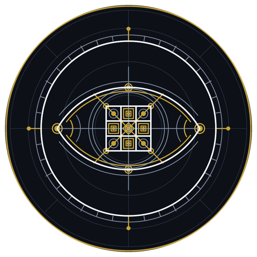

<a href="https://geometor.github.io/seer/"></a>

# GEOMETOR • SEER

<a href="https://github.com/geometor/seer/blob/main/LICENSE"></a>

**An AI-driven framework for solving abstraction and reasoning challenges.**

## Overview

SEER is an AI-driven framework for finding functions to transform inputs to outputs from a set of training data. It combines natural language understanding, visual reasoning, and code generation to identify patterns and develop algorithmic solutions.

## Key Features

- **Multi-role AI Collaboration**: specialized roles ("dreamer" and "coder") analyze problems and generate solutions.
- **Structured Workflows**: supports default and incremental problem-solving approaches.
- **Comprehensive Logging**: records every step of the reasoning and solution process.
- **Visualized Outputs**: generates rich visual representations of puzzles and solutions.
- **Code Generation**: transforms natural language reasoning into executable Python code.

## Architecture

SEER is built around a collaborative AI system where different roles analyze and solve puzzles:

1. **Dreamer**: Analyzes puzzle examples, identifies patterns, and describes transformations.
2. **Coder**: Converts the dreamer's insights into executable code.
3. **Workflows**: Orchestrate the interaction between roles.
4. **Session Management**: Records all interactions, solutions, and results.

## Installation

```bash
 git clone https://github.com/geometor/seer.git
 cd seer
 python -m venv .venv
 source .venv/bin/activate
 pip install -e .
```
## Usage

SEER requires a configuration directory with an `index.yaml`.

```python
 from pathlib import Path
 from geometor.seer import Seer
 from geometor.seer.config import Config

 # Load configuration
 config = Config(Path("./config"))
 seer = Seer(config)
 # ... run logic
```
For command-line tools:

```bash
 seer_rebuild_indexes --session_dir path/to/sessions
```
## Resources

- **Source Code**: https://github.com/geometor/seer
- **Issues**: https://github.com/geometor/seer/issues
