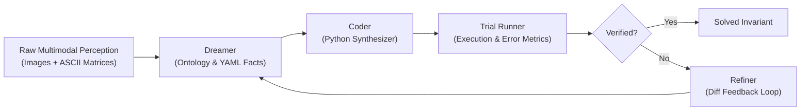
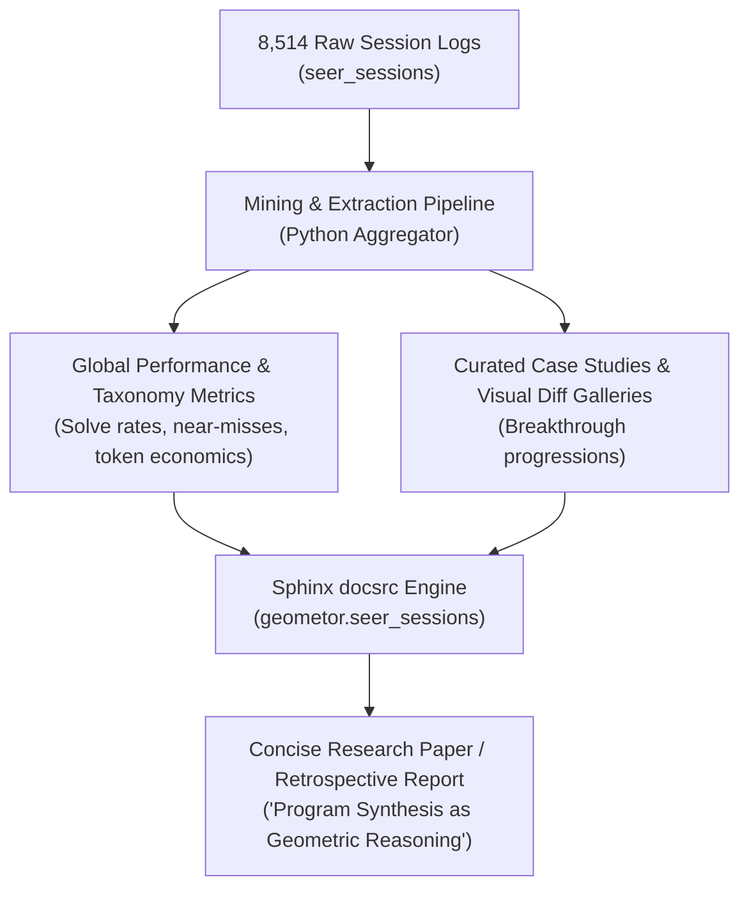
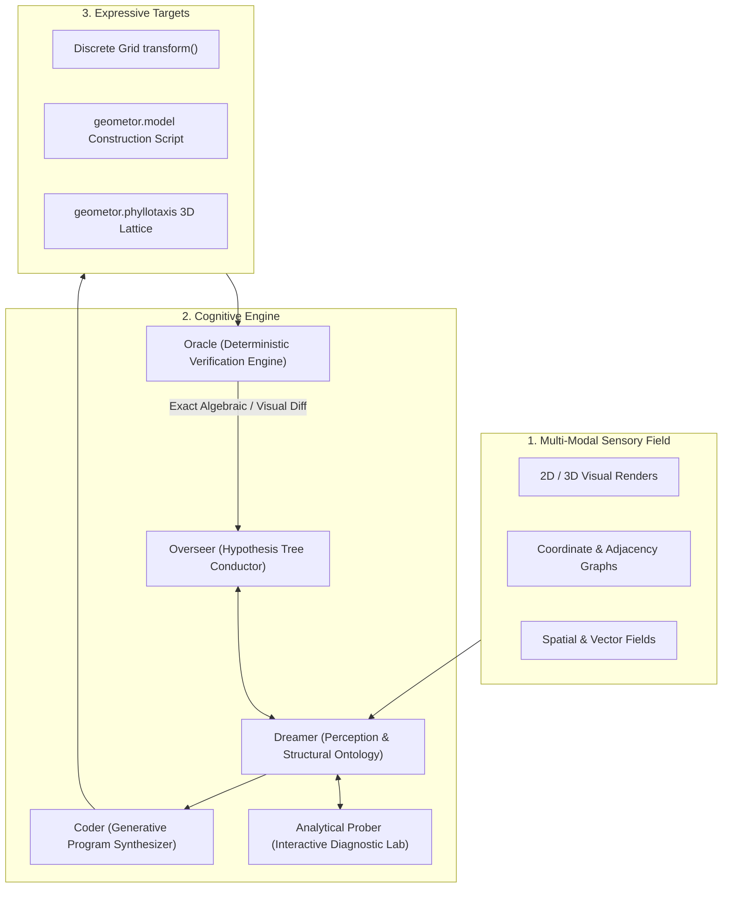

# SEER: The Synthetic Geometer
## Vision, Retrospective, and the Path to SEER 2.0

> *"Perception is the reception of form; discernment is the recognition of invariant truth."*

---

## Executive Summary

The **SEER** initiative within **GEOMETOR** represents an exploration at the intersection of artificial intelligence, constructive geometry, and abstract reasoning. 

This document synthesizes:
1. **The Foundations of SEER 1.0**: The breakthrough of program synthesis as verifiable reasoning across 8,514 empirical trial runs.
2. **The SEER 1.0 Retrospective & Publication Strategy**: Mining, organizing, and presenting our multi-gigabyte session corpus via an automated Sphinx showcase and technical paper.
3. **The Architectural Paradigm of SEER 2.0**: Moving from passive observation to active scientific inquiry through queryable diagnostic probes, multimodal sensory loops, and human-AI pair intelligence.
4. **The GEOMETOR Convergence**: Connecting SEER directly to Euclid's *Elements* (the G-Index DAG), `geometor.model` (symbolic compass-and-straightedge), and `geometor.phyllotaxis` (growth patterns, golden proportions, and dynamical symmetry).

---

## I. SEER 1.0: Foundations & Empirical Corpus

### 1. The Core Paradigm: Synthesis Over Guessing
Traditional approaches to visual reasoning tasks (such as the Abstraction and Reasoning Corpus, ARC-AGI) attempt direct token prediction of output matrices. SEER 1.0 pioneered a fundamentally sound alternative: **generating an executable, verifiable Python program (`transform()`) that embodies the latent rule.**



### 2. The 8,514-Run Corpus
Across 14 distinct session suites in `geometor/seer_sessions`, SEER conducted **8,514 task problem-solving runs** spanning 475 session batches:

| Corpus / Suite | Batches | Runs | Character of Benchmark |
| :--- | :---: | :---: | :--- |
| `sessions` (Main) | 29 | 2,232 | Core ARC puzzle exploration |
| `sessions_001` - `005` | 281 | 2,614 | Progressive pipeline testing & multi-step refinement |
| `sessions_ARCv2_eval` / `train` | 67 | 1,571 | Official ARC-AGI v2 benchmark sets |
| `sessions_ConceptARC` | 21 | 481 | Concept-grounded spatial & invariant challenges |
| `sessions_1D` / `optorex_1D` | 76 | 1,467 | 1D cellular automata & sequence logic |
| `sessions_mini_arc` | 1 | 149 | Compact concept validations |
| **Total** | **475** | **8,514** | **Rich Longitudinal Dataset** |

Every run preserved:
- Exact multi-modal input states (task PNGs and string grids).
- Model prompt histories, response times, token counts, and step latencies.
- Intermediate code files (`py_01.py` through `py_08.py`), error traces, and test matrices.
- Granular comparison metrics (color palette conservation, dimension match, diff pixel counts, percent accuracy).

---

## II. The Retrospective Strategy: Wrapping SEER 1.0

Before leaping entirely into next-generation development, we must curate and publish the findings of SEER 1.0:



### Key Deliverables for Phase 1
1. **Session Miner Script (`scripts/mine_sessions.py`)**:
   - Traverses all 14 session directories.
   - Extracts structured JSON summaries containing solve status, best trial score, iteration counts, and failure classification.
2. **Taxonomy Analysis**:
   - Classifies tasks into structural categories: Topology/Enclosure, Symmetry/Reflection, Movement/Gravity, Counting/Parity, Color Mapping.
   - Computes accuracy distributions, showing where the Dreamer-Coder loop excelled and where it hit cognitive barriers.
3. **Sphinx Documentation & Living Logs (`docsrc/`)**:
   - Integrates regular developer log entries (`docsrc/log/YY.DDD-HHMMSS.rst`) capturing our collaborative workflow.
   - Generates interactive, rich RST/HTML pages showcasing the data on GitHub.
4. **The Retrospective Report / Paper**:
   - A formal paper detailing the architecture of SEER 1.0, the empirical results over 8,500 runs, and the structural lessons that motivate SEER 2.0.

---

## III. SEER 2.0: The Co-Intelligence Architecture

SEER 2.0 evolves SEER from a linear prompt chain into an **autonomous synthetic laboratory** operating in deep collaboration with phi ARCHITECT.



### The New Cognitive Capabilities

1. **Active Diagnostic Probing (`seer.probes`)**:
   - Instead of static prompt dumping, the agent actively queries a mathematical toolkit:
     - `probe_symmetry(target)`: Checks reflectional axes and rotational orders.
     - `probe_periodicity(target)`: Identifies checkerboards, stripes, and repeating lattices.
     - `find_components(target)`: Identifies connected objects, hulls, and cavities.
     - `probe_collinearity(points)`, `detect_golden_ratio(segments)`: Exact geometric diagnostics.
2. **Multi-Perspective Active Vision**:
   - The agent can request camera orbits, cross-sections, and layer isolations in 2D and 3D.
   - The agent visually inspects the renders of its own synthesized code.
3. **Paired Co-Intelligence Narrative**:
   - The development process itself is treated as a continuous intellectual dialogue between phi ARCHITECT and Antigravity, logged as living historical entries.

---

## IV. The GEOMETOR Convergence

The ultimate realization of SEER 2.0 is its integration across the GEOMETOR universe:

```
┌─────────────────────────────────────────────────────────────────────────┐
│                           GEOMETOR ECOSYSTEM                            │
├───────────────────────────┬─────────────────────────────────────────────┤
│ KNOWLEDGE SUBSTRATE       │ • euclid (Source text & semantic parsing)   │
│                           │ • elements (G-Index dependency DAG)         │
├───────────────────────────┼─────────────────────────────────────────────┤
│ CONSTRUCTIVE ENGINE       │ • model (Exact SymPy compass & straightedge)│
│                           │ • divine (Golden section & harmonics)       │
│                           │ • phyllotaxis (Spirals & packing lattices)  │
├───────────────────────────┼─────────────────────────────────────────────┤
│ SYNTHETIC INTELLIGENCE    │ • seer 1.0 (8,514-run empirical archive)    │
│                           │ • seer 2.0 (The Autonomous Co-Explorer)     │
│                           │ • seer_navigator (TUI Visual Inspector)     │
└───────────────────────────┴─────────────────────────────────────────────┘
```

### The Euclid Benchmark (`geometor.elements`)
- **Mission**: Codify Euclid’s 465 propositions into executable `geometor.model` scripts.
- **Workflow**: SEER 2.0 ingests the proposition text and G-Index prerequisites $\to$ Dreamer perceives the constructive moves $\to$ Coder writes the pure compass-and-straightedge script $\to$ Oracle verifies exact algebraic theorems via SymPy.
- **Discovery**: Beyond re-creating Euclid, SEER 2.0 searches for minimal construction paths (Occam's Compass) and discovers novel geometric invariants across dense divine configurations.

---

## V. Strategic Phasing

```
┌───────────────────────────────────────────────────────────────────┐
│ PHASE 1: SEER 1.0 Retrospective & Publication                    │
│ 1.1 Mining Pipeline across 8,514 session runs                     │
│ 1.2 Global Metrics, Taxonomy & Near-Miss Analysis                 │
│ 1.3 Sphinx docsrc integration & developer logging                 │
│ 1.4 Retrospective Paper & Presentation on GitHub                  │
├───────────────────────────────────────────────────────────────────┤
│ PHASE 2: SEER 2.0 Architecture & Diagnostic Engine                │
│ 2.1 Modular subagent framework (Overseer, Dreamer, Coder, Oracle) │
│ 2.2 Heuristic Probes Library (seer.probes)                        │
│ 2.3 Visual inspection feedback loop                               │
│ 2.4 Baseline validation on ARC & ConceptARC                       │
├───────────────────────────────────────────────────────────────────┤
│ PHASE 3: The Euclid & Elements Construction Harness               │
│ 3.1 G-Index Integration with geometor.model                       │
│ 3.2 Automated proposition solver for Euclid Book I                │
│ 3.3 Phyllotaxis & dynamical symmetry exploration                  │
└───────────────────────────────────────────────────────────────────┘
```
